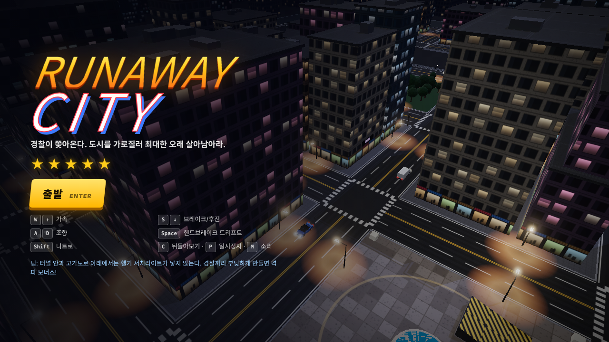
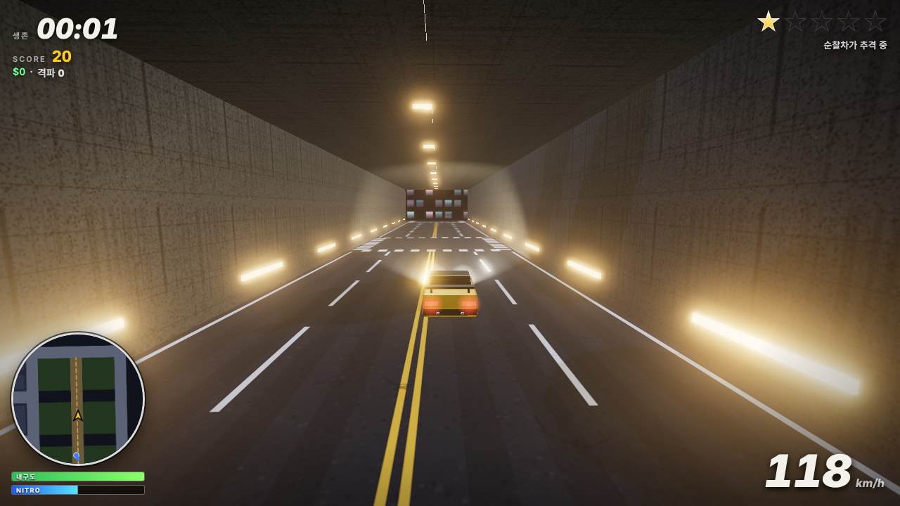
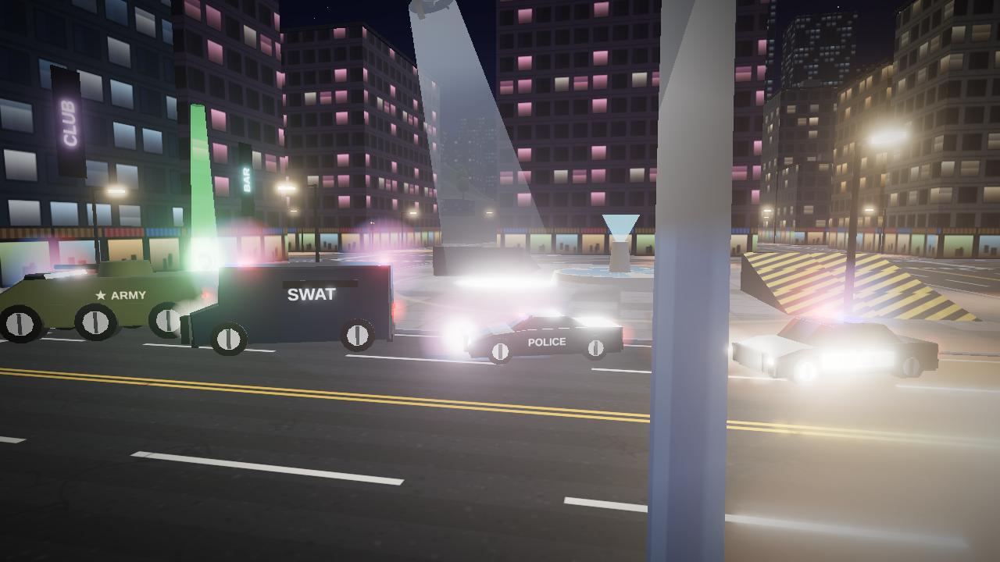

# RUNAWAY CITY — 도심 추격전

밤의 도심에서 경찰 추격을 피해 최대한 오래 살아남는 Three.js 아케이드 레이싱 게임.
처음부터 도망자 신세로 시작하고, 오래 버틸수록 수배 단계(★1~★5)가 올라가며 순찰차 → 인터셉터 → 헬기 서치라이트 → SWAT 트럭·바리케이드·스파이크 → 군 장갑차·헬기 2대가 차례로 투입된다.



| 터널 | 경찰 차량들 |
| --- | --- |
|  |  |

## 플레이

```bash
npm install
npm run dev        # http://127.0.0.1:5188
npm run build      # dist/ 에 정적 빌드
npm run preview    # 빌드 결과 미리보기
```

Node.js 20 이상이 필요하다.

### 조작

| 키 | 동작 |
| --- | --- |
| `↑` | 가속 |
| `↓` | 브레이크 · 후진 |
| `←` `→` | 조향 |
| `Space` / `X` | 핸드브레이크 드리프트 |
| `Shift` / `Z` | 니트로 |
| `C` | 뒤돌아보기 |
| `P` / `Esc` | 일시정지 |
| `M` | 소리 켜기/끄기 |
| `R` | 재시작 |
| `Enter` | 시작 · 다시 하기 |

오른손은 방향키, 왼손은 Space·Shift·Z·X·C에 두는 배치다.

게임패드(표준 매핑)와 모바일 터치 버튼도 지원한다.

### 규칙

- **WRECKED**: 내구도가 0이 되거나 강에 빠지면 끝.
- **BUSTED**: 경찰차 근처에서 거의 멈춘 채로 있으면 포위 게이지가 차오르고, 가득 차면 체포.
- 점수 = 생존 시간 × 수배 단계 + 현금 + 경찰 격파 보너스(SWAT ×2, 장갑차 ×4) + 점프 착지.
- 경찰의 시야에서 벗어나면 별이 깜빡이며 수배도 상승이 절반으로 느려진다. 경찰은 마지막 목격 지점으로 몰려든다.

### 맵 (13×13 격자, 약 730m × 730m)

| 구역 | 특징 |
| --- | --- |
| 고가도로 A (동서, 10m) | 도시를 가로지르는 고가. 양 끝 램프로 진입. 아래는 기둥이 늘어선 "다리 아랫길" — 헬기가 볼 수 없다 |
| 고가도로 B (남북, 16m) | 더 높은 고가. A 위를 입체 교차로 지나간다. 램프 아래로도 차가 지나갈 수 있다 |
| 원형 교차로 4곳 | 가운데 섬(오벨리스크)을 돌아 나가야 한다. 경찰·차량 AI도 섬을 돌아서 지나간다 |
| 운하와 다리 | 서쪽 남북 운하. 다리는 5곳뿐. 다리 없는 곳엔 강 점프대(속도가 부족하면 강에 빠짐) |
| 언덕 터널 | 북동쪽 언덕을 관통하는 터널. 시야 차단 + 헬기 회피 |
| 주차장 | 주차된 차들 사이 통로로 빠져나가는 넓은 공간 |
| 중앙 광장 · 공원 3곳 · 골목 | 분수와 점프대, 나무 사이 대각선 지름길, 블록을 가로지르는 좁은 골목 |

### 수배 단계

| 단계 | 시작 시점 | 투입 |
| --- | --- | --- |
| ★1 | 시작 | 순찰차 2대 |
| ★2 | 수배도 30 | 최대 4대, 고속 인터셉터 |
| ★3 | 70 | 경찰 헬기 1대 (서치라이트 추적) |
| ★4 | 120 | SWAT 장갑트럭, 바리케이드, 스파이크 스트립 |
| ★5 | 180 | 군 장갑차, 헬기 2대 |

수배도는 초당 1씩 오르고, 경찰을 격파할 때마다 +12.

## 참고한 게임

- **FFX Runner / On The Run** (Officine Pixel, 2004) — 노란 차로 들이받는 차들에게서 도망치는 원작 감성
- **GTA 시리즈** — 별 수배 시스템, 시야 이탈 시 깜빡이는 별, 헬기
- **Need for Speed: Most Wanted (2005)** — 단계별 추격 강화, 바리케이드와 스파이크 스트립
- **Smashy Road / Escape Road** — 생존형 아케이드 추격

## 기술 구성

- Three.js + TypeScript + Vite. 외부 모델·이미지·사운드 파일 없이 **전부 절차적으로 생성** (차량, 건물 파사드 텍스처, 네온 간판, 효과음과 음악은 Web Audio 합성).
- 커스텀 아케이드 물리: 차량은 원 2개 충돌체, 건물·기둥·난간은 AABB, 고가도로·램프·점프대는 높이 함수가 있는 주행면.
- 경찰 AI: 도로 그래프 A* 경로 탐색 + 시야 판정 시 예측 추격/들이받기 + 장애물 회피 수염 + 끼임 탈출.
- 후처리: UnrealBloom + ACES 톤매핑, 달빛 그림자는 플레이어를 따라 이동.
- 저사양 대응: 터치 기기에서 해상도·그림자·교통량 축소, 프레임이 떨어지면 해상도를 자동으로 낮춤.

```
src/
  game/       Game.ts (상태·루프·점수), config.ts (튜닝 값)
  world/      CityLayout (맵 데이터·충돌·경로그래프), CityBuilder (메쉬), textures
  entities/   Vehicle (물리), VehicleModels (절차적 모델), Helicopter
  systems/    PoliceSystem, TrafficSystem, AIDriver, Physics, Effects, PickupSystem, AudioSystem, CameraRig
  ui/         Hud (HUD·미니맵)
```

`?debug`를 URL에 붙이면 lil-gui 튜닝 패널(노출, 블룸, 무적, 수배 고정)이 열린다.

## GitHub Pages 배포

`.github/workflows/deploy.yml`이 포함되어 있다. 저장소 **Settings → Pages → Source**를 **GitHub Actions**로 바꾸고 `main`에 푸시하면 자동으로 빌드·배포된다. `vite.config.ts`의 `base: './'` 덕분에 저장소 이름과 상관없이 동작한다.

## 테스트

```bash
npx playwright install chromium   # 최초 1회
npm test                          # 데스크톱 키보드 + 모바일 터치 주행 테스트
```

이미 설치된 크롬을 쓰려면 `PW_EXECUTABLE=/path/to/chrome npm test`.
